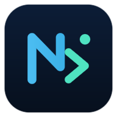
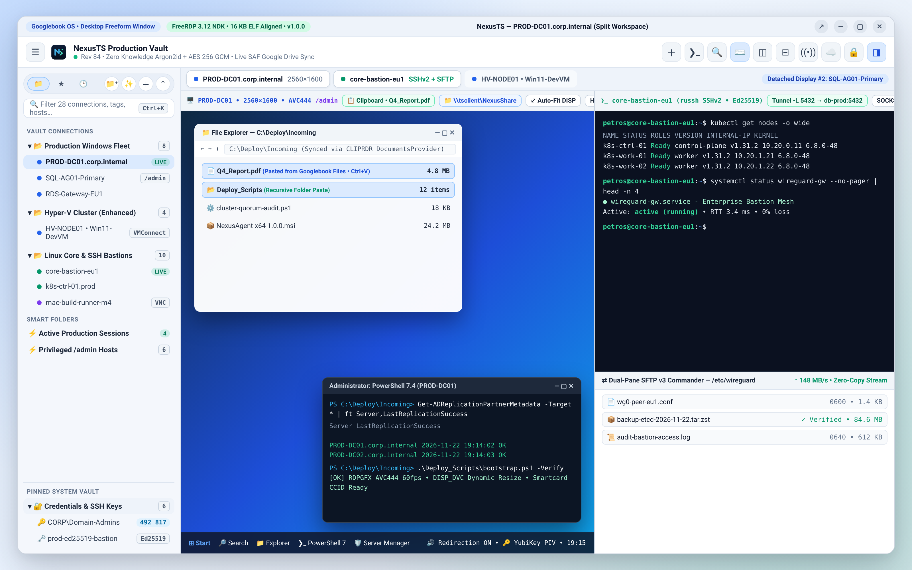
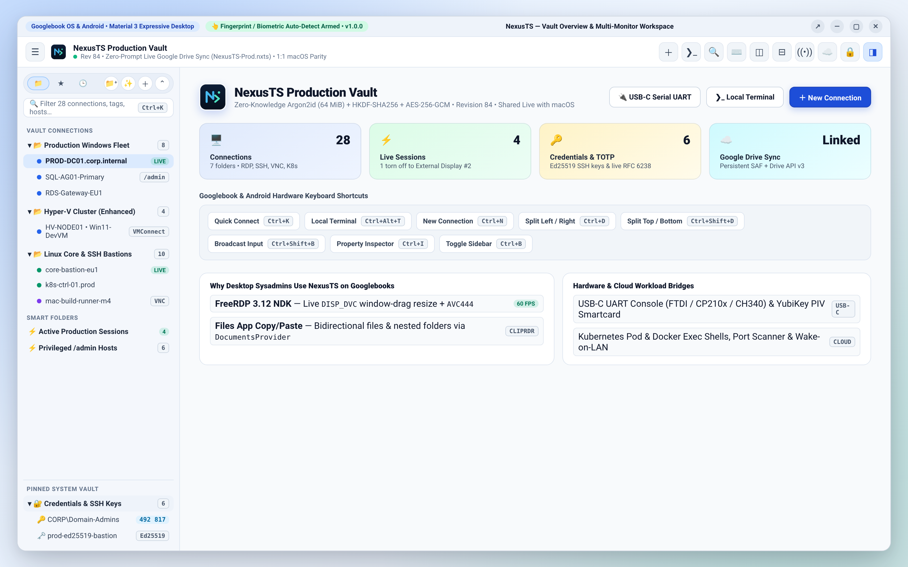
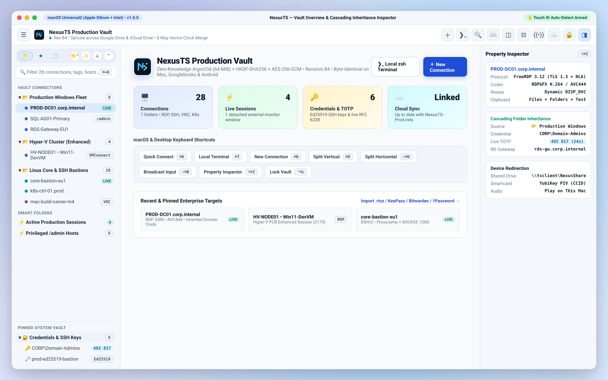
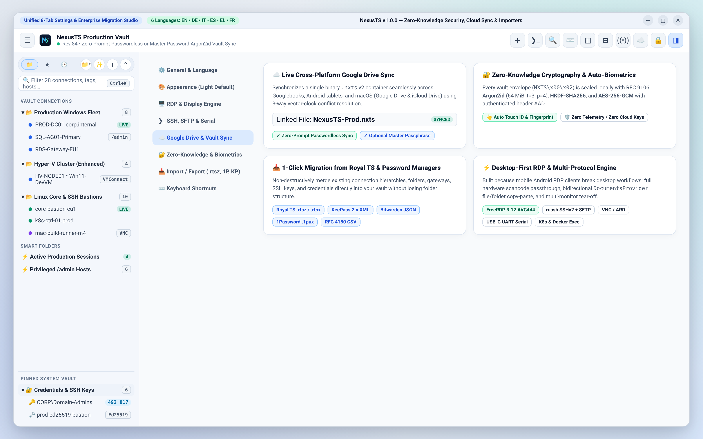

<div align="center">



# NexusTS `v1.0.0`

**Desktop-Class Remote Management, FreeRDP 3.12, SSHv2, SFTP & Zero-Knowledge `.nxts` Connection Workspace**  
*Native for **Googlebook OS & Android** (`arm64-v8a` + `x86_64`) and **macOS Universal2** (Apple Silicon + Intel)*

[](https://github.com/petrosvassiliou/NexusTS/releases/tag/v1.0.0)
[](https://github.com/petrosvassiliou/NexusTS/releases/tag/v1.0.0)
[](#zero-knowledge-nxts-v2-vault--live-cloud-sync)

[**Download Latest Release (`v1.0.0`)**](https://github.com/petrosvassiliou/NexusTS/releases/tag/v1.0.0) · [**Production Deployment Guide**](docs/PRODUCTION_DEPLOYMENT.md)

</div>

---

## Why NexusTS Exists

Existing Android-based RDP and remote desktop managers were designed around phone touchscreens—not real desktop keyboards, multi-monitor docking stations, or large enterprise server fleets. On **Googlebooks**, **Android desktop windowing**, and **tablets with trackpads**, traditional Android RDP clients fall short:

- Fixed resolutions instead of live **`DISP_DVC` dynamic window-drag resizing** and **HiDPI scaling**.
- Broken or non-existent **bidirectional file & folder copy/paste** with the system `Files` app (*"File operation is not supported"*).
- Swallowed hardware keyboard shortcuts (`Win`, `Alt+Tab`, `F1–F12`, `Ctrl+V`) and laggy right-click context menus.
- Isolated single-connection screens with **no split-pane tiling**, **no cascading folder credential inheritance**, **no Royal TS `.rtsz` compatibility**, and **no zero-knowledge cross-platform vault sync**.

**NexusTS `1.0.0`** solves this from the ground up: a unified, light-first desktop remote management workspace inspired by **Royal TS**, powered by **C++20 FreeRDP 3.12** and **Rust (`russh`, `argon2`, `aes-gcm`)**, sharing a single byte-identical encrypted `.nxts` v2 vault across **Googlebook OS / Android** and **macOS**.

---

## High-Resolution Platform Screenshots (`3200×2000` Retina)

### 1. Googlebook OS & Android — Live Split-Pane FreeRDP 3.12 + `russh` SSHv2/SFTP (`com.nexusts.app`)
*Freeform desktop windowing, side-by-side FreeRDP 3.12 (`AVC444`, `/admin`, `Auto-Fit DISP`, `HiDPI 200%`), bidirectional `DocumentsProvider` file & recursive folder copy/paste with Googlebook `Files`, `russh` SSHv2 + Dual-Pane SFTP v3 Commander, and multi-monitor tab tear-off.*



### 2. Googlebook OS & Android — Unified Vault Overview Dashboard & Hardware Shortcuts
*1:1 desktop workspace parity with macOS: live telemetry cards, pinned RFC 6238 TOTP credentials, Googlebook hardware keyboard shortcuts (`Ctrl+K`, `Ctrl+D`, `Ctrl+Shift+B`), USB-C Serial UART console, and automatic fingerprint sensor unlock.*



### 3. macOS Universal2 Edition (`com.nexusts.app.macos` — Apple Silicon & Intel, macOS 14+)
*Unified workspace UI with native macOS Sonoma/Sequoia window chrome, automatic Touch ID hardware sensor detection, Vault Overview Dashboard, `⌘K` Quick Connect, and `⌥⌘I` Cascading Folder Inheritance Inspector.*



### 4. Unified 8-Tab Settings, Zero-Knowledge Google Drive Sync & 1-Click Migration Studio
*Zero-prompt passwordless or Master-Passphrase Argon2id + AES-256-GCM live Google Drive sync, 1-click non-destructive import from Royal TS (`.rtsz`/`.rtsx`), KeePass XML, Bitwarden, 1Password (`.1pux`), and CSV, localized across 6 languages (`EN`, `DE`, `IT`, `ES`, `EL`, `FR`).*



---

## Feature Matrix (`v1.0.0`)

| Capability | Googlebook OS & Android (`APK` / `AAB`) | macOS Universal2 (`DMG` / `ZIP`) |
| :--- | :---: | :---: |
| **Unified Light-First Workspace & Vault Overview** | Yes (Jetpack Compose M3 Expressive) | Yes (SwiftUI + AppKit) |
| **Recursive Split-Pane Tiling & Tab Tear-Off** | Left/Right, Top/Bottom, External Display Tear-Off | `HSplitView`/`VSplitView` + Detached Windows |
| **RDP Engine** | FreeRDP 3.12 C++20 NDK (`AVC444`, `DISP_DVC`) | FreeRDP 3.12 Universal2 (`AVC444`, `DISP_DVC`) |
| **Bidirectional RDP File & Folder Copy/Paste** | Native `DocumentsProvider` (`Files` app + Drag & Drop) | Native `NSPasteboard` (`Finder` + `⌘C`/`⌘V`) |
| **Hyper-V Enhanced Session (`VMConnect` 2179)** | Yes (Preconnection Blob PCB + Auto-Heal) | Yes (Preconnection Blob PCB + Auto-Heal) |
| **SSHv2, Bastion ProxyJump & Port Forwarding** | Rust `russh` (`-L`, `-R`, `-D` SOCKS5, `.cast`) | Rust `russh` + Local `/bin/zsh` PTY |
| **Dual-Pane SFTP v3 & FTP File Commander** | Streaming SFTP v3 + SAF Integration | Dual-Pane Finder + SFTP v3 |
| **VNC / Apple Remote Desktop & Web Sessions** | RFB / ZRLE + Isolated Web Sessions | RFB + 1-Click `Screen Sharing.app` + `WKWebView` |
| **Hardware USB-C Serial UART & YubiKey PIV** | `UsbManager` UART (`9600–921600`) + CCID APDU | IOKit `/dev/cu.*` + Smartcard Redirection |
| **Kubernetes, Docker & Network Diagnostics** | K8s/Docker Exec & Logs + Ping/Scan/WoL | K8s/Docker Socket + 6-Tool Net Studio |
| **Zero-Knowledge `.nxts` v2 Live Cloud Sync** | Google Drive SAF + Drive REST API v3 | Google Drive + iCloud Drive |
| **Automatic Biometric Unlock** | Biometric / Googlebook Fingerprint Auto-Prompt | Automatic Touch ID & Apple Watch Detection |
| **Royal TS, KeePass, Bitwarden & 1Password Import** | `.rtsz`, `.rtsx`, `.xml`, `.json`, `.1pux`, `.csv` | `.rtsz`, `.rtsx`, `.xml`, `.json`, `.1pux`, `.csv` |

---

## Downloads & Installation (`v1.0.0`)

All signed release artifacts and `SHA256SUMS` manifests are published on [**GitHub Releases (`v1.0.0`)**](https://github.com/petrosvassiliou/NexusTS/releases/tag/v1.0.0):

- **Googlebook OS & Android (`arm64-v8a` + `x86_64`, 16 KB ELF Page-Aligned)**:
  - Download `NexusTS-v1.0.0-googlebook-android-release.apk` (signed with APK Signature Scheme v2/v3/v4, RSA-4096, Play-Protect compliant with built-in GitHub & Play updater).
- **macOS 14 Sonoma / macOS 15 Sequoia (`arm64` + `x86_64` Universal2)**:
  - Download `NexusTS-v1.0.0-macOS-Universal.dmg` (or `.zip`) and drag **NexusTS.app** to `/Applications`.

---

## Zero-Knowledge `.nxts` v2 Vault & Live Cloud Sync

Both platforms read and write the exact same binary **`.nxts` v2 (`NXTS\x00\x02`)** container:

- **Authenticated Cryptography:** Key derivation via **RFC 9106 Argon2id** (`64 MiB, t=3, p=4`), subkey expansion via **HKDF-SHA256**, and payload encryption via **AES-256-GCM** with header Additional Authenticated Data (AAD).
- **Frictionless or Master-Passphrase Modes:** Sync across Google Drive out of the box with **zero master-password prompts** using NexusTS's transparent authenticated envelope, or lock your vault behind a custom Master Passphrase with **automatic Touch ID / Fingerprint hardware detection**.
- **Conflict-Free Multi-Device Sync:** Concurrent edits on a Mac and a Googlebook / Android device are merged deterministically at the object level using **3-way vector-clock delta resolution** (`VaultDeltaConflictResolver`).

---

## Repository Architecture

```text
NexusTS/
├── app/                             # Android & Googlebook OS MainActivity, DetachedSessionActivity, E2E Robolectric Suite
├── core/
│   ├── ui/                          # Material 3 Expressive Light-First Theme, BSP Split Tiling, Desktop Shortcut Engine
│   ├── vault/                       # .nxts v2 Crypto, Cascading Folder Inheritance, .rtsz/KeePass/Bitwarden/1Password Importers
│   └── gdrive-sync/                 # Persistent SAF & Google Drive REST v3 Live Sync + 3-Way Vector-Clock Merge
├── protocols/
│   ├── rdp/                         # FreeRDP 3.12 TextureView, DISP_DVC Resize, NexusRdpClipboardDocumentsProvider, CCID Bridge
│   ├── ssh/                         # xterm-256color Terminal, Port-Forwarding Studio, Dual-Pane SFTP v3, USB-C Serial UART
│   └── vnc/                         # RFB/ZRLE VNC, Kubernetes Pod & Docker Exec/Logs, Isolated Web Sessions, NetUtils
├── feature/workspace/               # Unified Desktop Workspace, Overview Dashboard, Sidebar Tree, 8-Tab Settings, 6-Locale i18n
├── native/
│   ├── cpp/                         # C++20 FreeRDP 3.12 Session, RDPGFX/AVC444, CLIPRDR File Streams, DISP_DVC, AAudio/CoreAudio
│   └── rust/                        # Rust Workspace (nexusts-crypto, nexusts-terminal, nexusts-transfer, nexusts-vnc, nexusts-netutils)
├── macos/                           # Native Swift + SwiftUI/AppKit macOS 14+ App (Universal2 arm64 + x86_64)
└── docs/screenshots/                # High-Resolution 3200x2000 Retina Platform Screenshots
```

---

## Build & Test Quickstart

### Android & Googlebook OS
```bash
# Run Rust unit tests, headless Compose/Robolectric E2E suite, and assemble signed Release APK & AAB
cargo test --manifest-path native/rust/Cargo.toml
./gradlew testDebugUnitTest assembleRelease bundleRelease
```

### macOS Universal2 (`arm64` + `x86_64`)
```bash
./scripts/build-macos-native.sh --universal
swift test --package-path macos
./scripts/package-macos-app.sh --universal
```
